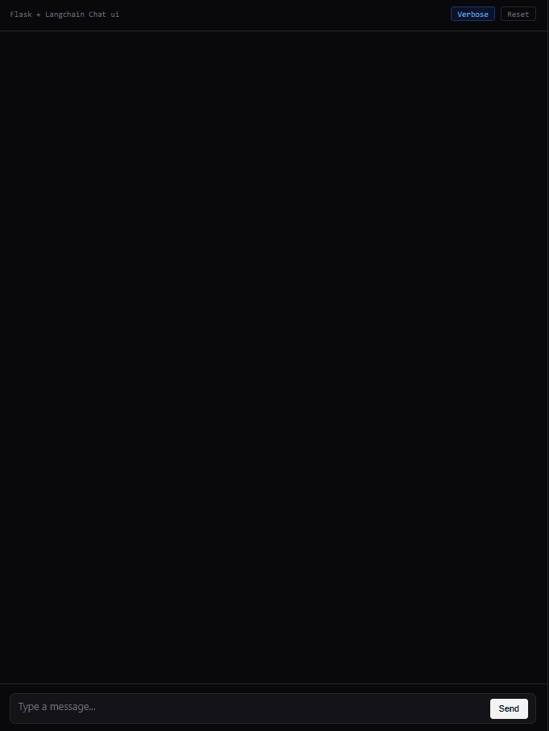

# LangChain Live Streaming Chat UI

<p align="center">
  
</p>

A lightweight, modern Flask chat application demonstrating **LangChain & LangGraph real-time streaming** to a minimal SaaS frontend via **Server-Sent Events (SSE)**.

Built following the [LangChain Streaming Specification](https://docs.langchain.com/oss/python/langchain/streaming) (`stream_mode=["messages", "updates", "custom"]`, `version="v2"`), featuring dual display modes (ChatGPT-style Normal mode vs. Full Verbose tracing).

---

## ✨ Features

- **⚡ Token-by-Token Streaming (`messages` mode)**: Live token output and tool-call argument generation streamed with low latency.
- **📡 Custom In-Tool Progress (`custom` mode)**: Uses LangGraph's `get_stream_writer()` to emit intermediate status updates directly from within tools (e.g. *"Querying satellite..."*).
- **🔄 Dual Display Modes (Normal vs. Verbose)**:
  - **Normal Mode (ChatGPT-Style)**: Displays a transient inline status while a tool executes (e.g., `calculator...`). The status is automatically replaced by the streaming text response once generation begins.
  - **Verbose Mode**: Reveals the full technical inspection drawer with raw logs, outputs, and model reasoning traces.
- **🧱 Clean Separation of Concerns (`@stream_sse`)**: All SSE headers, LangChain chunk parsing, error handling, and completion signals are abstracted into a reusable decorator in `streaming_utils.py`. The Flask endpoint simply returns `agent.stream(...)`.
- **🎨 Modern SaaS Minimal Design**: Designed with the Hallmark `modern-minimal` aesthetic—dark zinc canvas, hairline borders, conversational chat bubbles, and zero template bloat.
- **🧠 Multi-Turn Memory**: Checkpointed conversation threads powered by LangGraph's `InMemorySaver`.

---

## 📁 Project Structure

```text
BasicChatUiLangchain/
├── app.py                # Flask application, LangChain agent setup, and @stream_sse route
├── streaming_utils.py    # Reusable @stream_sse decorator & LangChain chunk adapter
├── requirements.txt      # Python dependencies
├── .env                  # API keys and endpoint configuration
├── templates/
│   └── index.html        # Clean, stripped-down frontend template (22 lines)
└── static/
    ├── css/
    │   └── style.css     # Modern SaaS dark stylesheet & chat bubble styles
    └── js/
        └── chat.js       # SSE reader (ReadableStream) and dynamic UI manager
```

---

## 🚀 Getting Started

### 1. Prerequisites
- Python 3.10+ (tested on Python 3.13)
- An Azure OpenAI or OpenAI API endpoint

### 2. Installation

1. Navigate to the project directory:
   ```bash
   cd BasicChatUiLangchain
   ```

2. Install dependencies:
   ```bash
   pip install -r requirements.txt
   ```

### 3. Environment Configuration

Create or update your `.env` file in the root directory:

```env
DEPLOYMENT_NAME=DeepSeek-V4-Flash
AZURE_OPENAI_ENDPOINT=https://your-resource-name.openai.azure.com/
AZURE_OPENAI_API_KEY=your_azure_openai_api_key
```

*(Note: Standard OpenAI API keys or other providers can also be used by swapping the chat model configuration in `app.py`.)*

### 4. Run the Application

Start the Flask development server:

```bash
python app.py
```

Open your browser and navigate to:
```
http://127.0.0.1:5000
```

---

## 🛠️ Architecture & Streaming Pipeline

```
┌──────────────────┐               POST /stream               ┌───────────────────────┐
│     Frontend     │ ───────────────────────────────────────> │  Flask Route Handler  │
│ (Fetch + Stream) │ <─────────────────────────────────────── │ (@stream_sse wrapper) │
└──────────────────┘          text/event-stream chunks        └───────────┬───────────┘
         ▲                                                                │
         │ Chunks:                                                        ▼
         │ - {"type": "token", "content": "..."}               ┌───────────────────────┐
         │ - {"type": "tool_chunk", "name": "..."}             │    LangChain Agent    │
         │ - {"type": "custom", "content": "..."}              │ (LangGraph v2 stream) │
         │ - {"type": "tool_result", "result": "..."}          │   with Tools & Memory │
         │ - {"type": "done"}                                  └───────────────────────┘
```

### The `@stream_sse` Decorator

Instead of writing repetitive streaming boilerplate across routes, the `@stream_sse` decorator in `streaming_utils.py` handles:
1. Active Flask request context preservation via `stream_with_context`.
2. Setting standard SSE headers (`Cache-Control: no-cache`, `Content-Type: text/event-stream`, `X-Accel-Buffering: no`).
3. Normalizing LangGraph `StreamPart` v2 chunks (`messages`, `updates`, `custom`) into clean UI JSON events.
4. Appending terminal `{"type": "done"}` events and trapping runtime errors into `{"type": "error"}` frames.

**In `app.py`, your route is literally 5 lines:**

```python
from streaming_utils import stream_sse

@app.route("/stream", methods=["POST"])
@stream_sse
def stream_chat():
    data = request.get_json() or {}
    return agent.stream(
        {"messages": [{"role": "user", "content": data.get("message")}]},
        stream_mode=["messages", "updates", "custom"],
        version="v2",
        config={"configurable": {"thread_id": data.get("thread_id")}},
    )
```

---

## 🧪 Built-In Example Tools

1. **`get_weather(city: str)`**: Fetches weather forecasts and emits multi-step progress with `get_stream_writer()` (*"📡 Querying satellite..."*, *"🌡️ Parsing temperature..."*).
2. **`calculator(expression: str)`**: Safely evaluates mathematical operations and emits progress events.
3. **`search_knowledge_base(query: str)`**: Simulates an enterprise documentation search with live embedding scans.

---

## 📄 License

MIT
